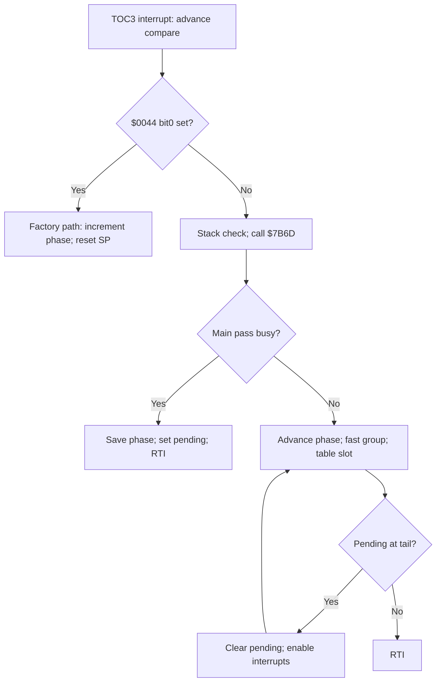

# BMHM factory scheduler: ROM structure and bounded execution

The ordinary main scheduler is a phase counter, conditional fast groups, and a
16-entry ROM word table. The separate factory/service callback reads a complete
word from RAM. This pass establishes the dispatch operations, wrapper call order,
local state transitions, and bounded execution scenarios. It does not establish
a general dynamic-priority algorithm or whole-program semantic completion.

## Evidence and address convention

All decoded instructions and table words come from the complete 65,536-byte
`BMHM.BIN`, SHA-256:

```text
6188975246cf0042979f3a1694e3d43a2985a1452e7547a3b9e8a66d10e65004
```

The full file includes `$0000-$3FFF` FF padding. Mapped ROM CPU addresses
`$4000-$FFFF` equal file offsets. CPU `$0000` is RAM; a ROM-only extract with
the padding removed would instead map file offset zero to CPU `$4000`.

`bmhm_scheduler_rom_evidence.json` retains the reviewed bytes and image identity.
The HAC text is preserved. `factory_scheduler_instructions.csv` decodes actual
bytes; it does not reassemble the text. The small decoder follows NXP's
[M68HC11 programming reference](https://www.nxp.com/docs/en/reference-manual/M68HC11ERG.pdf),
especially opcode pages 1-4, branch semantics, and the instruction tables.

## Interrupt, main pass, and overrun

The actual vector word at `$FFE4` is `$793D`, the output-compare-3 handler.
Its first nine bytes are `FC 30 1A C3 03 33 FD 30 1A`: read `$301A`, add
`$0333` (819), and write `$301A`. The next compare is based on the previous
compare, rather than the time at which the handler happens to execute.



The ordinary timer path enables interrupts at `$7958`. It checks `X=SP+1`:
`$03B0..$03F7` is accepted when not busy, and `$03B0..$03EE` when busy.
Outside the applicable range it sets `$003A bit3`, clears busy, and replaces SP
with `$03F6` before continuing. This is a recovery path; restoring a valid
interrupted context still depends on the retained stack frame.

`$7B6D` runs **before** the busy check. Its ordered nested calls are `$91A3`,
`$F245`, `$7C13`. Between them it performs an ADC conversion and stores the
rounded four-sample average at `$014E`; after `$7C13`, it writes the word
`$0600 | byte[$014C]` to `$3068`. The board-level meaning remains a separate
hardware contract. This service runs on ordinary hardware timer entries,
including busy reentries. A tail catch-up pass bypasses this service.

| State | Actual operation |
|---|---|
| `$0000 bit0` | Set at every TOC3 entry, before the factory gate |
| `$004F bit2` | Busy: set at `$7989`, cleared at `$7A52` or stack recovery |
| `$0003` | Snapshot of `$0002` on busy reentry, before returning |
| `$003A bit5` | Pending: set on busy reentry, cleared before tail catch-up |
| `$003A bit3` | Set when the stack-range check fails |

The pending state is **one bit, not a count**. Several busy timer arrivals can
coalesce into one extra main pass. The bounded execution test injects three
timer interrupts into one active pass: `$7B6D` runs four times in total, but
only two main passes complete. The normal phase advances twice, not four times.
This makes wall-clock call frequency conditional on workload and interrupt
delivery. It does not establish an unbounded queue of missed jobs.

## Phase and nominal cadence

Initialization executes `86 0E 97 02` at `$7431`: `$0002=$0E`. The main pass
increments the byte before dispatch, resets it to zero when the incremented
value equals `$A0`, and stores it at `$79C5`. The first normal slot is therefore
`$F`, followed by `$0` at phase `$10`. The established normal phase sequence
contains 160 values, `$00..$9F`.

Initial timer arming at `$745E-$7469` sets `$301A=TCNT+8` and enables mask `$A0`
at `$3022`. The first compare delay is eight timer counts. Subsequent TOC3
entries advance the compare by 819 counts.

ROM initialization sets the timer prescaler to E/16. Using the repository's
existing 2,097,152-Hz E-clock contract gives the following nominal periods;
this pass adds no physical oscillator or timing measurement.

| Admission group | Timer periods | Nominal interval |
|---|---:|---:|
| Ordinary tick service / every main pass | 1 | 6.248474 ms |
| Phase bit0 group | 2 | 12.496948 ms |
| Phase low-two-bit subgroup | 4 | 24.993896 ms |
| Each table slot | 16 | 99.975586 ms |
| Each alternating branch inside slot 4 | 32 | 199.951172 ms |
| Phase wrap | 160 | 999.755859 ms |

At wrap the code toggles `$0043 bit5`. If `$004F bit7` is set, it also increments
the word `$00FD`, stores it unless the increment wrapped to zero, and compares
the temporary X with `wordROM[$495D]` before conditionally clearing `$0004 bit4`.
At `$FFFF`, the stored word stays `$FFFF` while the comparison uses wrapped X=0.
That detail is preserved in the execution test rather than replacing it with
an assumed saturated arithmetic equation.

## Fast groups before the table

Each normal main pass first updates a service-requested bit: when `$003B bit4`
and `$038F bit2` are both set, `$0072 bit7` is copied from `$0390 bit2`.
Otherwise this code leaves `$0072 bit7` unchanged. It then recomputes `$003B bit2`
as `($0051 bit3 set) OR ($003B & $18 nonzero)`, under SEI/CLI.

The next branch reads `$001A bit5` at `$79D9`. The mode names below describe
this scheduling branch; its co-writers and conditional lifetime are joined in
[the flag contract](FACTORY_FLAG_LIFETIMES.md).

| Branch | Conditions | Ordered calls before the table |
|---|---|---|
| Special, even | `$001A bit5=1`, phase bit0=0 | None |
| Special, odd | `$001A bit5=1`, phase bit0=1 | `$AC51`, then `$AA,$55` writes to `$303A` |
| Ordinary common | `$001A bit5=0` | `$7BA7`, before the following subgroup |
| Ordinary even | phase bit0=0 | `$9167`, `$A466`, `$D14E`, `$D1F6`, `$F5E8` |
| Even subgroup 0 | phase & 3 = 0 | `$D03E`, `$AE85` |
| Even subgroup 2 | phase & 3 = 2 | `$B56B` |
| Ordinary odd | phase bit0=1 | `$7D4B`, `$CDF7`, optional `$F3E4` |
| Odd subgroup 1 | phase & 3 = 1 | `$B32D` |
| Odd subgroup 3 | phase & 3 = 3 | `$93D0`, `$C4E5` |

`$F3E4` is skipped only when `$003B bit4` and `$0391 bit7` are both set at its
gate. That branch sets `$0044 bit2` and `$0043 bit7`. The actual helper is:

```text
F3E4: B6 30 66   LDAA $3066
F3E7: 88 80      EORA #$80
F3E9: B7 30 66   STAA $3066
F3EC: 39         RTS
```

This proves a board-bit toggle. Its physical purpose is not assigned here.
The HAC decoding around this entry is misaligned and must not supply stack or
state-access evidence for the helper.

Conditions are evaluated when their instructions execute. Callees and
interrupts can change state between tests. The stated call periods count
admissions when their gates hold, not proven completions of all callee work.

### Reentry before the busy flag

The [equivalence interrupt pass](FACTORY_EQUIVALENCE_INFORMATION_GAPS.md)
executes three additional complete TOC3 entries at selected outer boundaries.
Before the busy test at797D they produce main phases1,2,3,4; after busy is set
at798C, or during the body at7A44, they coalesce into phases1,2. Tick service
runs on all four IRQ entries. These structural admission witnesses use the
existing explicit callee stubs and do not establish full controller execution
time. Interrupt return is verified against both the original PC and SP.

### Resident stack and a complete shared-output witness

The [stack/shared-output contract](FACTORY_STACK_AND_SHARED_OUTPUT_CONTRACT.md)
adds a21-byte resident TOC3 prefix envelope below handler-entry SP, excluding
the nine-byte interrupt frame and asynchronous nesting. Supplied code and SP
assignments are boundaries. WAI has already stacked its frame before wake;
the entry guard does not reserve every later callee's stack bytes.

A further witness executes every selected resident callee through complete
phases3/4. Timer reentry during C514's gear-shadow merge can replace a newly
stepped IAC field with an older B-register value; pending catch-up then reaches
the realF411 publication. This goes beyond the earlier scheduler-only callee
stubs. Physical timer spacing and motor response remain separate observations.

## The 16 slots

Actual bytes `$7A44-$7A50`:

```text
D6 02 C4 0F CE 7A 85 58 3A EE 00 AD 00
```

They implement:

```text
slot = RAM[$0002] & $0F
X = wordROM[$7A85 + 2*slot]       // high byte, then low byte
JSR 0,X
```

`LDX 0,X` reads both bytes from the selected ROM entry. Its zero operand is an
indexed displacement. Both ordinary and special fast-group branches reach
this table. Factory-test redirection at `$794E` bypasses the entire normal pass.

| Slot | Landing | Ordered wrapper calls / action |
|---|---|---|
| 0 | `$7AA6` | `$C56F`, `$CF15` |
| 1 | `$7AAD` | `$C583`, `$C668`, `$ADAA` |
| 2 | `$7AB7` | SEI; `$F20D`; CLI |
| 3 | `$7ABD` | `$F5CF`, `$D4EB`, `$C514` |
| 4 | `$7AC7` | `$C8B1`, then the alternating group below |
| 5 | `$7B03` | `$D3B0`, `$D472`; `$C6BB` if ROM `$400F bit6=0` |
| 6 | `$7B14` | `$CB15`, `$CE10` |
| 7 | `$7B1B` | `$C514`, `$F5DC`, `$9E99`, `$CA6B`, `$ACA7` |
| 8 | `$7B2B` | `$CEBB` |
| 9 | `$7B2F` | `$CF16`, `$A2B0`, `$D4DA` |
| A | `$7B39` | `$D2B2` |
| B | `$7B3D` | `$D4EB`, `$C514` |
| C | `$7B44` | `$CC35` |
| D | `$7B48` | `$CCC1`, `$DBFB`, `$DC89` |
| E | `$7B52` | No calls; set `$0004 bit2` if `$0051 bit2` remains set |
| F | `$7B5A` | `$C514`, `$C4F5`, `$E62D`, `$E6E5`, `$E286`; set `$0051 bit2` |

Slot 4 calls the following groups according to phase bit4. It then rebuilds
`$006F bits $24`: bit2 from `$0016 bit0`, and bit5 from `$0017 bit7`, retaining
the other bits of `$006F`.

| Phase bit4 | Calls after `$C8B1` |
|---|---|
| 0 | `$E75F`, `$E793`, `$C96A`, `$C9C0`, `$C9F7` |
| 1 | `$B9EE`, `$B99F`, `$EAB1`, `$EAE4`, `$C8D6`, `$C8FD` |

In stock BMHM `$400F=$10`, so the slot-5 `$C6BB` call is admitted. A separate
counterfactual fixture sets bit6 to verify the bypass; it is not a claim about
the current truck's `2.bin` calibration.

The foreground code `$746C-$74D2` services the slot-F `$0051 bit2` request by
reading and rewriting 16-byte RAM groups, then clears that bit at `$74B0`.
If it is still set when slot E next executes, slot E latches `$0004 bit2`.
This is an interaction with foreground work, not a slot-E subroutine list.

## Profiling words and the tail

At the tail the scheduler masks interrupts and clears busy. If `$0086 bit6`
is set, it selects a word at `$02D3 + 2*(phase & $0F)` and computes:

```text
elapsed = (word[$300E] - word[$301A] + 819) modulo 65536
if pending bit is set: elapsed = (elapsed + 819) modulo 65536
if elapsed > existing unsigned word: store elapsed
```

These are per-slot unsigned peak words in timer-count units. Coalesced pending
ticks and 16-bit wrap limit their interpretation as elapsed wall time. The
global writer join excludes an ordinary resident bit6 setter, including indexed
boot/self-copy owners. Signature-qualified `$F5DC -> $180C` can still call
supplied code while bit6 is clear; that module's effects remain unknown. See
[the extension interface](FACTORY_EXTENSION_MEMORY_INTERFACE.md).

## Factory/service path and its RAM callback

If `$0044 bit0` is set at `$794E`, the handler increments `$0002` directly and
jumps to `$FA5B`. It bypasses `$7B6D` and the main table. `$FA5B` sets SP to
`$03FF`, discarding the interrupted stack context, qualifies two ADC samples,
then enables interrupts and services the watchdog before checking `$0364`.
The first ADC sample must be `$28..$63` inclusive; the second must exceed `$1A`.
Failing qualification reaches SWI at `$FA82`.

| `$0364` | Path at `$FA8D-$FAC7` |
|---|---|
| `$02` | Set `$0001 bit0`; call through wordRAM `$038E/$038F` |
| `$03` | Call the toggle helper; dispatch only if `$0001 bit0` was already set |
| `$01` | Call the toggle helper; clear `$0001 bit0`; copy 32 bytes from `$0390` to the RAM destination word at `$038E`; complement `$0364` |
| Other | Call the toggle helper; continue into output-cycling qualification |

The actual callback bytes at `$FAA2` are `FE 03 8E AD 00`: `LDX $038E`, then
`JSR 0,X`. This reads the complete RAM word; its possible values remain open.
It is a service callback, not the ordinary 16-slot dispatch.

There is also a concrete producer path for that word. With `$0050 bit3` set,
`$F9C3` loads Y=`$038E`, `$F9C7` loads the received length from `$0365`, and
the branch at `$F9CA` enters the copy loop at `$FA10`. That loop copies bytes
from `$036C` onward into Y onward. A two-byte test payload `AB CD` consequently
produces word `$ABCD` at `$038E`, which the callback reads unchanged. The test
stubs the destination routine after recording the actual JSR target.
The full serial framing/checksum state machine and every legal callback target
remain outside this bounded path. This factory-mode branch bypasses the
ordinary command-4 length clamp; no universal 11-byte limit is asserted here.

After callback/upload, `$FAC7` jumps to the `$FBD4` busy-wait loop. Later timer
entries reenter the factory path. In the separate output-cycling branch,
`$FB06-$FB0D` retains `$0002` through `$4F` or replaces it with zero; that clamp
is not applied to every factory-service entry. Normal scheduling instead has
the 160-phase wrap described above.

## State maps and listing defects

The new maps cover explicit accesses in the reviewed scheduler spans and
intraprocedural control flow for 63 directly called routine roots. Direct
branches/jumps are followed; nested calls are recorded as boundaries. They
contain 2,939 per-root memory-access rows, including 262 unresolved indexed
rows. These are not a replacement denominator for the older whole-listing
1,038 unresolved indexed-access sites (the current effective overlay has 1,036).
Shared code can occur under several roots. The later nested/spark passes now
classify 216 of the 262 baseline rows as address sets, six as frames, four as
parameters, eight as pruned, and 28 as unresolved; see `FACTORY_NESTED_STATE_FLOW.md`.

The comparison records 32 listing discrepancies. This includes missing lines,
malformed operands, wrong numeric literals, and misaligned code/data decoding;
it does not mean 32 distinct algorithms were wrong. Examples:

| ROM location | Actual evidence | Listing problem |
|---|---|---|
| `$74A4` | `C6 10`: load B with 16 | Literal shown as `#010` |
| `$A0FA-$A113` | Reachable branch/store sequence in `$9E99` flow | Addressed rows omitted |
| `$A361/$A363` | `BEQ $A398` at `$A361`, `LDAA $5B02` at `$A363` | Branch assigned to `$A363`; next instruction has no addressed row |
| `$B32D` | `BD B3 34`: call `$B334` | Entry lies inside the listing's preceding misdecode |
| `$B99F` | `F6 01 1A`: load B from `$011A` | Entry lies inside a preceding misdecode |
| `$E75F/$E763` | `BRSET $3B,#$04,$E792`; `LDX #$5B00` | Instructions declared as FDB data |
| `$F3E4-$F3EC` | Board-bit toggle shown above | Misaligned instructions / missing addressed entry |
| `$FA72` | `81 28`: compare A with decimal 40 | Operand printed as hex `$40` |

For these covered instructions, use the ROM map. The effective whole-listing
and legacy indexes now apply the reviewed corrections through the audited ROM
overlay. The original HAC text remains unchanged; unreviewed rows remain
source-derived. See `factory_rom_overlay_audit.csv` and `FACTORY_CODE_STRUCTURE.md`.

`factory_scheduler_gate_producers.csv` byte-checks direct listing writer
candidates for the scheduler gates. It preserves whole-byte stores as candidates
requiring value flow and explicitly marks gates with no direct writer candidate.
For example, the indexed receive-copy path supplies service bytes even though
there is no direct `STAA $038F` in the listing. Indexed clears also initialize
state: the actual `$716A` clear call zeros `$0036-$00FF`, including busy and
pending, through the page-3 `STY 0,X` instructions at `$F315` onward.

## Artifacts and validation

Files are under `maps/structure/`:

| File | Contents |
|---|---|
| `bmhm_scheduler_rom_evidence.json` | Stock image identity, captured bytes, clock basis, counts |
| `factory_scheduler_slots.csv` | All 16 words, landing addresses, wrapper order, special actions |
| `factory_scheduler_calls.csv` | 91 call/target rows with reviewed guards and nominal periods |
| `factory_scheduler_control_edges.csv` | Local branches, fallthrough, calls, conditional call returns |
| `factory_scheduler_state_accesses.csv` | Explicit local state and hardware accesses |
| `factory_scheduler_gate_producers.csv` | Byte-checked direct writer candidates and open indexed producers |
| `factory_scheduler_callee_summary.csv` | 63 root dossiers: direct bytes read/written, indexed accesses, nested calls |
| `factory_scheduler_callee_accesses.csv` | Individual ROM-decoded access sites for those roots |
| `factory_scheduler_instructions.csv` | Actual bytes and decoding for covered instructions |
| `factory_scheduler_listing_discrepancies.csv` | Every comparison discrepancy, retained for review |

The 18 scheduler tests execute the captured bytes with the existing HC11 CPU,
independently of the map decoder and guard formulas. They cover the complete
160-phase cycle, slot order, alternate slot-4 groups, service gates, the first
slot, nested overruns, stack thresholds, profiling arithmetic, wrap behavior,
factory redirection, callback dataflow, and the 32-byte upload path.

External callees return through a real ROM RTS with A/B/X/Y clobbered. Their
RAM effects are not executed. The ADC completes immediately and timer values
are fixture-controlled; the suite proves bounded instruction/control behavior,
not the engine, all interrupts, worst-case execution time, or physical timing.
Enabling the real RAM-clear proof exposed a CPU-core error: page-3 `1A EF`
had selected X for the stored value instead of Y. The small prefix fix also
corrects related `1A EE`/`1A AC` operations, with a separate CPU regression test.

```bash
python tools/build_factory_scheduler.py --rom /path/to/BMHM.BIN
python tools/build_factory_scheduler.py --check-recorded
python -m unittest discover -s tests -p 'test_factory_*.py' -v
cd hac31_romsim
python -m unittest discover -s tests -v
```

`--check-recorded` checks only excerpt/output consistency. For fresh image
verification use `--rom`; `--write` updates the captured evidence and maps.

Remaining closure: propagate nested-callee and indexed memory effects, resolve
profiling-enable and mode-flag lifetimes, integrate the byte-backed listing
corrections into the broader source indexes, enumerate service callback targets,
and measure workload/interrupt timing. These are explicit dependencies for fuel,
spark, idle, transmission, and diagnostic execution-context contracts.

The next pass is now recorded in `FACTORY_NESTED_STATE_FLOW.md`: it extends calls
to 234 ROM entries and resolves 216 of the preceding 262 indexed rows to
physical address sets, retaining frame/parameter roles and unknowns separately.
Use its nested-effect maps for the newer evidence; the original 63-root maps
remain the reproducible first-pass baseline.
